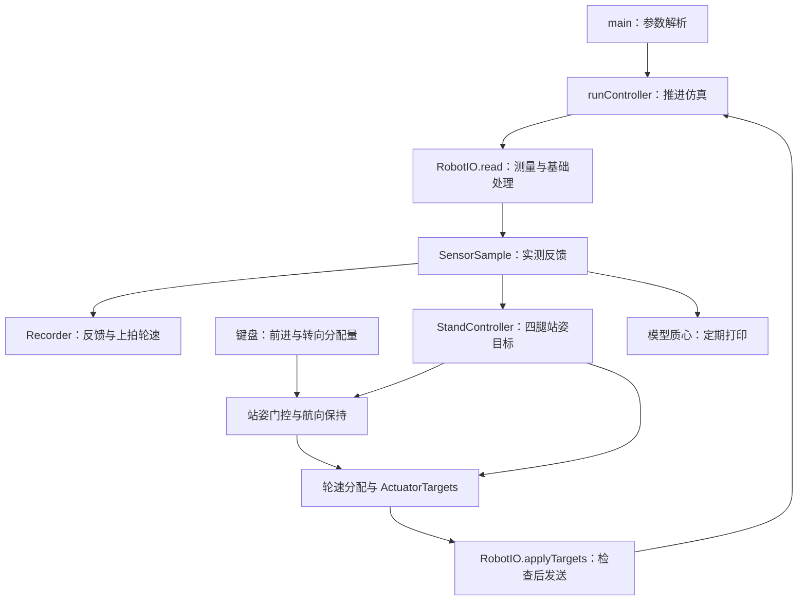

# 从主循环读懂当前机器人控制器

这份指南沿实际调用关系解释控制器。源代码注释解释函数内的实现，这里串起各个模块。所有路径都以本控制器目录为基准。

## 已接入主循环的功能

正常主循环已经执行四腿站姿准备、实测到位判断、键盘轮式行驶、航向保持和日志记录。整体质心由模型参数与实测角度计算，定期打印在控制台。

`CrawlController` 使用 `CrawlGait` 调度慢速爬行。`TrotController` 调度对角小跑。H 锁轮后，G 和 T 分别进入这两种模式。B 键可以在普通锁轮状态下执行小幅支撑平移。

仿真中，步态控制器通过 Supervisor 查询碰撞接触点。几何最低点用于估计轮缘高度，离地判据同时检查碰撞接触和几何高度。

## 第一条阅读路线：main → runController

先完整阅读 `wl_drive_cpp.cpp`。`main()` 调用 `parseRunOptions()` 取得启动选项，再进入 `runController()`。异常一路返回到入口统一报告；这不是发生异常后自动恢复并继续控制。

`runController()` 在循环外创建 `RobotIO`、`StandController`、运动学对象、航向控制器和记录器。这样设备句柄、轨迹起点、开始时刻和航向参考能跨帧保留。若把有状态控制器每拍重新创建，计时和参考就会不断重置。

以轮式模式为例，每个采样周期按以下顺序执行。

1. `robot.step()` 推进仿真，然后读取当前时间。
2. `RobotIO::read()` 读取设备，检查有限性，计算差分速度、位移和关节误差。
3. 有效反馈经过左前腿 FK 后，与上一执行区间已发送的轮子模式、轮速或保持角度一起写入 schema 5 日志。
4. 读取键盘并解码，启动等待结束且反馈有效时调用 `stand.update()`。
5. 根据本拍站姿阶段决定是否允许行驶；直行时增加航向 P 修正。
6. 把四腿关节目标与左右轮速组为 `ActuatorTargets`，交给 `RobotIO::applyTargets()`。

先记录上一执行区间，再发送下一执行区间的目标，保持日志的因果顺序。`stand_goal` 是每拍新建的局部输出，`stand` 是跨帧保留状态的控制器，两者不要混淆。

站姿 `Hold` 每拍重新判断，并非永久锁存。受扰动后关节误差超出容差，会重新进入 `WaitReached`，主循环随即暂停行驶；这是当前实现的行为。关节到位本身不证明机器人接地稳定。

## 第二条阅读路线：数据怎样跨层流动

阅读 `models.hpp`，再读 `config.hpp`。`SensorSample` 是测量与派生量，`StandGoal`、`GaitGoal` 是各算法阶段的输出，`ActuatorTargets` 才是统一交给执行层的数据。构造这些结构体不会发送电机命令。

| 类型或参数 | 数组形状 / 物理意义 | 单位与坐标系 |
|---|---|---|
| `JointAngles` | 一腿 HAA、HFE、KFE，不含轮电机 | rad |
| `LegPoses` | 四腿 × 三关节，LF、RF、LH、RH | rad |
| `WheelValues` | 四个轮子编码器值或速度，语义由字段确定 | rad 或 rad/s |
| `WheelCenters` | 四个轮心三维位置 | base，m |
| `MotionCommand` | 前进分配量与转向分配量 | rad/s，轮速空间 |
| `WheelCommand` | 左侧两轮、右侧两轮目标角速度 | rad/s |
| `SensorSample::position` | GPS 测点的位置 | 世界坐标系，m |
| `MassPoint::position_base_m` | 部件质心位置 | base，m |
| `CrawlStepPlan` 中的位置 | 本步开始时的冻结机身参考系 | m |

参考系与目标机身系目前只考虑相对平移，轴方向保持平行。固定的 `REFERENCE_CENTER_X_M` 是几何参考点偏移；整机质心会随姿态变化，GPS 点也不是自动等于整机质心。

## 第三条阅读路线：先读接口，再进实现

| 模块 | 负责什么 | 阅读重点 |
|---|---|---|
| `robot_io` | 封装传感器和执行器 | 设备所有权、位置/速度模式、差分历史、先验证再发送 |
| `rolling` | 键盘、航向保持、轮速分配与 H/R 保持状态 | 首次捕获固定角度、进入条件、模式与设备输出分工 |
| `trajectory` | 五次时间标度与平滑插值 | 实际时间与归一化进度、一次捕获起点 |
| `motion` | 单腿三关节到位判断 | 目标与实测的区别、误差容差和有限性检查 |
| `body_control` | 站姿与四腿目标组合 | 站姿轨迹、支撑平移、轮角补偿 |
| `crawl_controller` | 低速爬行 | 逐腿迈步、接地确认、停车与回中 |
| `wheel_ground` | 两种步态共用的轮地测量 | 碰撞点相对地面的高度判断接触，轮缘到地面的间隙辅助判断离地 |
| `trot_controller` | 对角小跑 | 转移重心、摆腿、确认落地与回中 |
| `gait` | 决定哪条腿、哪个阶段 | 状态转移后生成输出；计划接地与落地确认不同 |
| `kinematics` | 关节与几何位置转换 | X-Y-Y 变换链、候选解筛选、局部点变换 |
| `estimation` | 模型质心和几何接地点 | 同系质量加权、地面法向、几何估计的边界 |
| `recorder / metadata` | 逐帧日志与启动快照 | 实际轮速、字段顺序、磁盘快照不等于运行状态 |
| `file_snapshot / detail` | 文件指纹与 SHA-256 | 工程辅助，最后再读 |

只有设备层操作运动电机与测量传感器。键盘交互留在入口辅助函数，算法层只接收普通数据。这样的边界让运动学和轨迹可以脱离 Webots 单独核对。

## 在代码里认识 C++ 语法

| 写法 | 当前项目中的含义 |
|---|---|
| `wl::`、`类名::函数名` | 命名空间 / 类的作用域，说明名字属于谁 |
| `.hpp` 声明与 `.cpp` 定义 | 接口说明能做什么，实现说明怎样做 |
| `using LegPoses = ...` | 类型别名，不会分配一个机器人对象 |
| `std::array<T,N>` | 固定长度值类型；索引顺序由项目约定 |
| `const T&` | 只读借用已有对象，避免输入拷贝，不延长其生存期 |
| `auto`、`const auto&` | 推断类型；后者以只读引用访问元素 |
| `pointer->member` | 通过指针访问对象成员；设备指针先检查非空 |
| `optional->member` | 访问可选值成员，前提是已经确认有值 |
| `std::optional<T>` | 可有值可为空；用于无效反馈、尚未创建的轨迹 |
| `.emplace(...)` | 在 optional 内直接构造轨迹对象 |
| `Class(...) : member_(...)` | 构造函数的成员初始化列表，在函数体之前执行 |
| 函数后的 `const` | 承诺不修改该对象的普通成员状态 |
| `explicit` | 禁止从参数类型意外隐式转换成该对象 |
| `enum class` | 有作用域的枚举，如 `GaitPhase::Swing` |
| `static_cast<LegLink>(i)` | 明确转换类型；合法范围仍由调用者保证 |
| `[&](...) { ... }` | lambda 临时函数，以引用访问外层变量，用于候选解比较 |
| `return {}` / 数组成员 `{}` | 按类型进行值初始化；不能自动证明测量有效 |
| `throw` / `catch` | 报告非法参数或计算失败，交给上层处理 |

`Vec3` 和 `JointAngles` 当前底层类型都是三元素数组，编译器无法替我们区分“位置米”和“角度弧度”。阅读函数契约和变量后缀尤其重要。

## 算法阅读时抓住这几条关系

轨迹先把时间归一化，再计算五次平滑进度。起终点速度与加速度为零，是选择这条曲线的原因。

$$
u = \operatorname{clamp}\!\left(\frac{t-t_0}{T},0,1\right),
\qquad s(u)=10u^3-15u^4+6u^5
$$

三维插值用同一个进度控制每个坐标；摆动轨迹额外在参考系的 Z 轴叠加抬高量。`swingPosition()` 中传入的 `1.0` 代表归一化尺度，真实时长由步态状态机决定。

$$
\mathbf{p}(u)=(1-s)\mathbf{p}_0+s\mathbf{p}_1
             +4h\,s(1-s)\begin{bmatrix}0\\0\\1\end{bmatrix}
$$

逆运动学先枚举侧摆与膝弯曲的几何分支，再依次检查关节限位、用正解回代验证位置、选择最接近参考角的一组。不可达目标会报告失败，不会把任意错误角度强行裁剪成可执行目标。

$$
\mathbf{q}^{\ast}
=\underset{\mathbf{q}\in\mathcal{Q}_{\mathrm{valid}}}{\arg\min}
\sum_{j=1}^{3}(q_j-q_{\mathrm{ref},j})^2
$$

整机质心先要求每个部件的位置都表达在同一个 base 坐标系中，再按质量加权。`pointToBase()` 正是为局部质心和轮轴辅助点完成这段转换。轮心不随轮子自转改变，轮上的偏心点则会随自转改变。

$$
\mathbf{c}_{\mathrm{base}}
=\frac{\sum_{i=1}^{N}m_i\,\mathbf{p}_{i,\mathrm{base}}}
       {\sum_{i=1}^{N}m_i}
$$

接地点估计寻找圆柱轮沿地面法向的几何最低点，既考虑半径，也考虑轮子倾斜后的宽度边缘。它没有查询碰撞力，因此轮子悬空时也会返回几何候选点。支撑三角形中心只对三个候选位置求几何重心，不等于整机质心，也不能独立证明允许抬腿。

## 从 T 键读到四条腿的电机指令

`first_demo_cpp.wbt` 的 `controller "wl_drive_cpp"` 选择本目录的控制器。`supervisor TRUE` 允许读取轮节点的仿真接触点。程序入口 `runController()` 在 H 锁轮后响应 T 键，通过 `trot.emplace(...)` 在 `std::optional` 中构造控制器。此后每帧调用同一个对象，摆动开始时刻、对角组和上一帧目标都能保留下来。

`makeTrotCommand()` 把键盘解码结果变成小跑的前进和偏航指令。前进输入乘以标定系数得到落点步幅，实测车速还取决于支撑转移和接触反馈。仅按 A 或 D 时没有前进步幅，偏航指令改变摆动轮的落点，同时支撑腿带动机身转过一部分角度。

直行起步和回中后，步幅放大系数从 1.16 随已完成的换步次数逐渐升到 1.27，先以较短步幅建立对角支撑。连续直行满八次换步后，`needsWorkspaceRecenter()` 用正运动学求四个实测轮心，再跟站姿轮心比较。任一轮心在机身前后方向偏离超过 12 cm，或侧向偏离超过 7.5 cm，就提前回中。即使偏差较小，直行累计满 24 次也会回中。

直行在重心转移和落地时要求连续两帧接触确认，转弯与回中要求连续四帧。完成摆动轨迹后，还会检查预定的两个轮子确实离过地，才允许换组。

`TrotController::update()` 根据 `Phase` 推进动作。左前与右后为一组，右前与左后为另一组。先把质心移向将要承担支撑的对角线，再让另一组抬轮迈步。`updateSwingAndLanding()` 同时记录接触状态和轮缘高度。四轮连续着地、离地记录与计划一致后，交换支撑组。超时或离地记录不符时报告故障，保持上一组有效目标。

`beginNextStep()` 在四轮着地时根据 `Motion` 决定开新步还是先回中。直行、原地转和弧线之间切换时先回中。左右弧线采用相同的支撑节奏，可以在一对腿落地后直接换向，达到换步上限时仍先回中。按 R 请求退出时，`updateRecenter()` 等站姿关节角到位且四轮连续着地，再通知主循环切回轮式。

### 边走边转的轮心坐标

摆动腿的目标落点向转弯方向转过规划角，支撑腿同时带动机身转过其中一部分。弧线的机身转角比例由 `ARC_BODY_YAW_FRACTION` 控制，当前取 0.53。这个比例用于轨迹规划，实际航向由仿真反馈测量。

轮心目标最初用起摆时的机身坐标表示。先从目标轮心减去规划的机身位移，再乘逆旋转矩阵，就能得到新机身坐标下的轮心位置。

$$
\mathbf p_{\mathrm{new}}(t)
= R_z\!\left(-\theta(t)\right)
  \left(\mathbf p_{\mathrm{ref}}(t)-\Delta\mathbf p_B(t)\right).
$$

对应到 `sampleSwingCenters()` 的代码，`centers[leg]` 在变换前保存这一拍的参考轮心，`body_yaw` 是规划的机身偏航角，`advance_blend * swing_body_advance_` 按坐标分量给出规划位移。支撑轮的地面位置目标固定，轮心在机身坐标里的相对位置随之改变。之后统一求四腿逆解和轮角补偿。

转移重心时，用第二个支撑轮的水平位置减去第一个，得到支撑线的方向向量。质心投影在连线上的系数为

$$
\lambda
=\operatorname{clamp}\!\left(
\frac{(\mathbf{c}-\mathbf{p}_1)^{\mathsf T}\mathbf d}
{\mathbf d^{\mathsf T}\mathbf d},
\,0.30,\,0.70
\right),
\qquad
\mathbf{p}_{\mathrm{proj}}=\mathbf{p}_1+\lambda\mathbf d.
$$

这里的质心使用世界坐标系下的水平分量。`beginTransfer()` 计算从质心到投影点的位移并限幅。`sampleTransferCenters()` 随时间平滑施加这个位移，在机身坐标系中从各轮心目标减去机身的移动量。

`sampleSwingCenters()` 对摆动轮插值到新落点并叠加抬高量，对支撑轮加入横滚和俯仰的高度补偿。随后统一把轮心变换到前移、转动后的机身坐标系。`sampleTargets()` 调四腿逆解，选择接近起始关节角的可达解，再计算轮角补偿。`RobotIO::applyTargets()` 检查并向 Webots 电机发送同一帧的腿角和轮角。

阅读时可以从 `sampleTransferCenters()` 的 `auto&` 开始。循环变量直接引用数组中的轮心，所以修改分量会写回数组。再看 `sampleSwingCenters()` 的 `const SensorSample&`，它使用本帧实测姿态，调用期间只读。成员函数末尾的 `const` 约束函数只能读取控制器状态，相位和计数集中在 `update()` 中更新。
